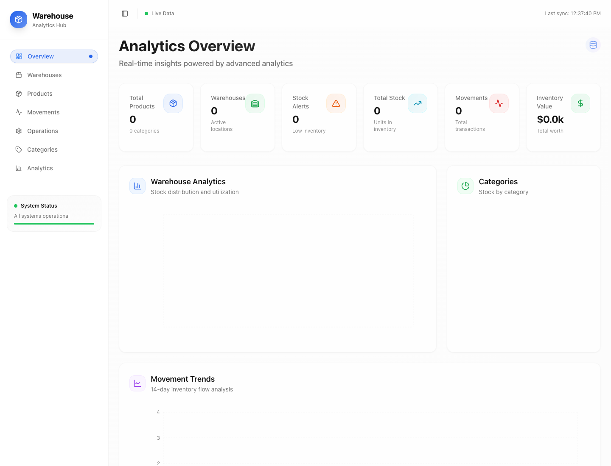
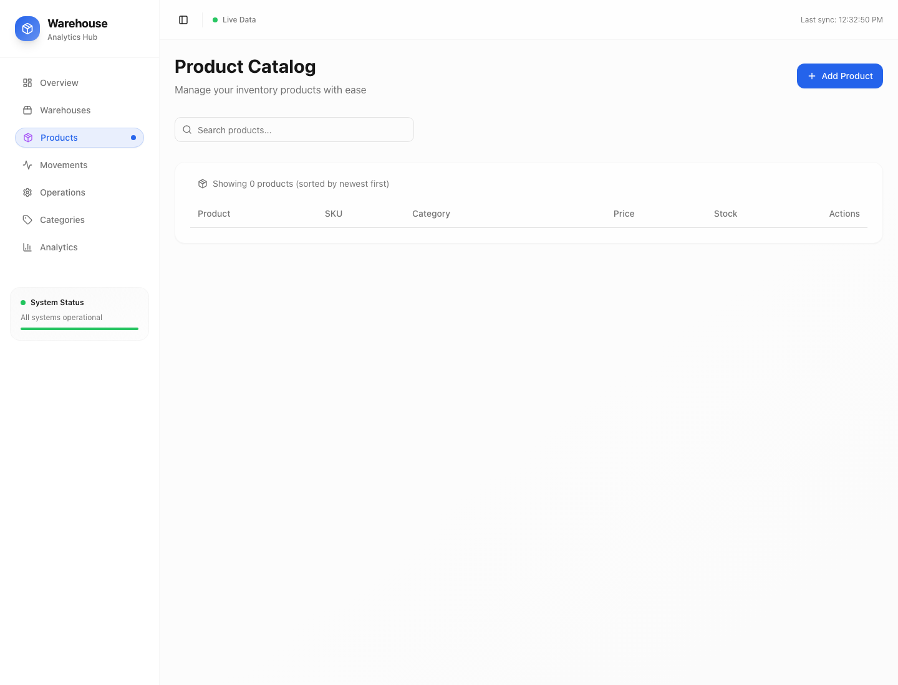

# Warehouse Wizard — Inventory and Operations Console

> A browser-based inventory workspace for managing warehouses, products, stock levels, movement history, categories and operational analytics.

**Project status:** working web prototype connected to Supabase for persistence. The screenshots in this README are from a fresh, isolated local run with placeholder connection values; the empty tables are intentional and contain no live inventory data.

## In-app screenshots

The app was allowed to finish loading before these screenshots were captured. The overview shows the dashboard layout and empty-data baseline; the products page shows the catalog controls and table structure.

## What the application manages

- **Warehouses:** named storage locations, locations, descriptions and capacity.
- **Products:** SKU, description, category, unit price, image URL and minimum stock threshold.
- **Inventory:** on-hand quantity for each product at each warehouse.
- **Movements:** incoming and outgoing stock, transfers between locations and manual adjustments.
- **Categories:** labels and colors used to group products.
- **Operations:** screens for maintaining inventory records and responding to stock issues.
- **Analytics:** dashboard KPIs and charts for stock distribution, movement history and inventory value.

A product is separate from its stock: one product can have inventory rows at several warehouses. This allows transfers to be represented as a source and destination movement rather than silently changing one global count.

## Data model

~~~mermaid
erDiagram
  CATEGORIES ||--o{ PRODUCTS : groups
  PRODUCTS ||--o{ INVENTORY : stocked_as
  WAREHOUSES ||--o{ INVENTORY : holds
  PRODUCTS ||--o{ INVENTORY_MOVEMENTS : records
  WAREHOUSES o|--o{ INVENTORY_MOVEMENTS : source
  WAREHOUSES o|--o{ INVENTORY_MOVEMENTS : destination

  CATEGORIES {
    uuid id PK
    string name
    string color
  }
  PRODUCTS {
    uuid id PK
    string sku UK
    string name
    decimal unit_price
    integer min_stock_level
    uuid category_id FK
  }
  WAREHOUSES {
    uuid id PK
    string name
    string location
    integer capacity
  }
  INVENTORY {
    uuid id PK
    uuid product_id FK
    uuid warehouse_id FK
    integer quantity
  }
  INVENTORY_MOVEMENTS {
    uuid id PK
    uuid product_id FK
    uuid from_warehouse_id FK
    uuid to_warehouse_id FK
    integer quantity
    string movement_type
  }
~~~

## Application architecture

~~~mermaid
flowchart LR
  USER[Warehouse operator] --> WEB[React and TypeScript app]
  WEB --> ROUTES[Overview, warehouse, product, movement and category screens]
  ROUTES --> HOOKS[Data hooks and query/cache layer]
  HOOKS --> CLIENT[Supabase browser client]
  CLIENT --> AUTH[Supabase API and database]
  AUTH --> TABLES[(Products, categories, warehouses, inventory, movements)]
  TABLES --> HOOKS
  HOOKS --> KPI[Dashboard metrics and charts]
  KPI --> USER
  ROUTES --> MUTATE[Create, update and movement actions]
  MUTATE --> CLIENT
~~~

### Stock movement flow

~~~mermaid
sequenceDiagram
  participant O as Operator
  participant UI as Warehouse Wizard
  participant DB as Supabase tables
  O->>UI: Choose product, quantity and movement type
  UI->>UI: Validate required fields and positive quantity
  UI->>DB: Record movement
  DB->>DB: Store movement history
  DB->>DB: Update per-warehouse inventory
  DB-->>UI: Return updated records
  UI-->>O: Refresh stock, alerts and analytics
~~~

## Technical stack

- React, TypeScript and Vite for the application.
- Tailwind CSS and shadcn-style UI components for the interface.
- Supabase JavaScript client for database reads and writes.
- Recharts for operational charts.
- Relational schema with foreign keys, unique SKU and product/warehouse constraints, non-negative stock, positive movement quantities and movement-type checks.

## Local setup

1. Use Node.js and npm.
2. Copy .env.example to .env and configure a Supabase project intended for this application.
3. Apply the SQL migrations under supabase/migrations.
4. Install dependencies with npm ci.
5. Start the development server with npm run dev.

The browser needs a Supabase URL and publishable key at build time. Never put a service-role key in a Vite variable: anything prefixed with VITE_ is exposed to the browser bundle.

## Security status — read before connecting data

This repository is an unauthenticated prototype. Its current example migration enables row-level security but then adds policies allowing unrestricted anonymous CRUD on all five tables. Those policies are suitable only for a disposable demo database with synthetic records. They do **not** protect real inventory, users or business data.

Before using it with real information, replace those policies with authenticated, least-privilege rules scoped to the user's organization and warehouse; add an authentication and authorization flow; and verify storage and API access separately. The public source history has been scrubbed of the repository's configured .env; this README uses placeholders only. The live database has not been changed by this documentation update.

## Current demo screenshot

The screenshot is an empty state captured against a deliberately invalid local Supabase endpoint. This prevents the capture from reading or changing any remote data. The zero counts are not a claim that a deployed warehouse has no stock; they show the clean first-run layout.

## License and source

The repository is public so the project can be inspected. No open-source license is included, so reuse rights are not granted by this README.
